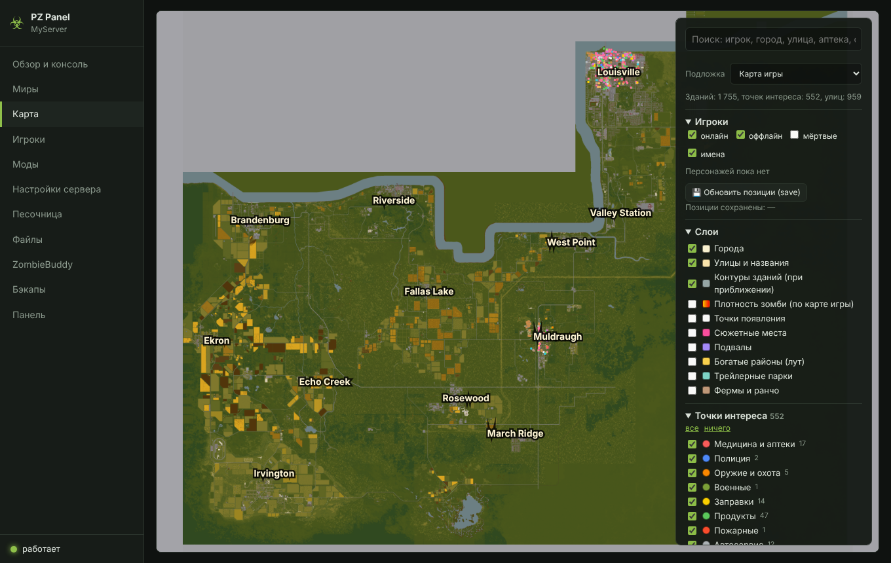

# PZ Panel

**🇷🇺 Русский** · [🇬🇧 English](#-english)

## 🇷🇺 Русский

**PZ Panel** — бесплатная веб-панель выделенного сервера Project Zomboid (Build 42). Небольшая программа на Java, которая работает рядом с сервером и открывается в браузере: консоль, моды (порядок, Мастерская, заморозка версий, автосортировка), несколько миров, живая карта, игроки, нагрузка, бэкапы. Windows и Linux, открытый код, ничего ставить не нужно. Интерфейс на русском и английском.

|  **Моды** |  **Автосортировка** |
|---|---|
|  **Карта** |  **Миры** |

**Скачать:** [Releases](https://github.com/Torivald/PZPanel/releases) (`PZPanel_<версия>_Windows.zip`, `PZPanel_<версия>_Linux.zip`) · **Руководство в Steam:** [PZ Panel](https://steamcommunity.com/sharedfiles/filedetails/?id=3823445245)

**Документация:**
[Описание](docs/RU/README.md) ·
[Установка](docs/RU/INSTALL.md) ·
[Настройки и конфиги](docs/RU/CONFIG.md) ·
[Моды](docs/RU/MODS.md) ·
[Карта](docs/RU/MAP.md) ·
[Docker](docs/RU/DOCKER.md) ·
[Техническое описание](docs/RU/ARCHITECTURE.md) ·
[Частые проблемы](docs/RU/TROUBLESHOOTING.md) ·
[История изменений](CHANGELOG.md)

---

## 🇬🇧 English

**PZ Panel** is a free web panel for a Project Zomboid (Build 42) dedicated server. A small Java program that runs next to the server and opens in a browser: console, mods (load order, Workshop, version freezing, auto-sorter), multiple worlds, a live map, players, load charts, backups. Windows and Linux, open source, nothing to install. The interface is available in Russian and English.

|  **Mods** |  **Auto-sorter** |
|---|---|
|  **Map** |  **English interface** |

**Download:** [Releases](https://github.com/Torivald/PZPanel/releases) (`PZPanel_<version>_Windows.zip`, `PZPanel_<version>_Linux.zip`) · **Steam guide:** [PZ Panel](https://steamcommunity.com/sharedfiles/filedetails/?id=3823445245)

**Documentation:**
[Overview](docs/EN/README.md) ·
[Installation](docs/EN/INSTALL.md) ·
[Configuration](docs/EN/CONFIG.md) ·
[Mods](docs/EN/MODS.md) ·
[Map](docs/EN/MAP.md) ·
[Docker](docs/EN/DOCKER.md) ·
[Technical description](docs/EN/ARCHITECTURE.md) ·
[Troubleshooting](docs/EN/TROUBLESHOOTING.md) ·
[Changelog](CHANGELOG.md)

---

Third-party components / Сторонние компоненты: [NOTICE.md](NOTICE.md)
