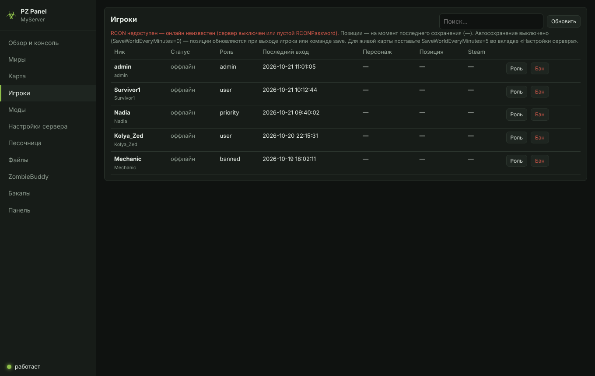
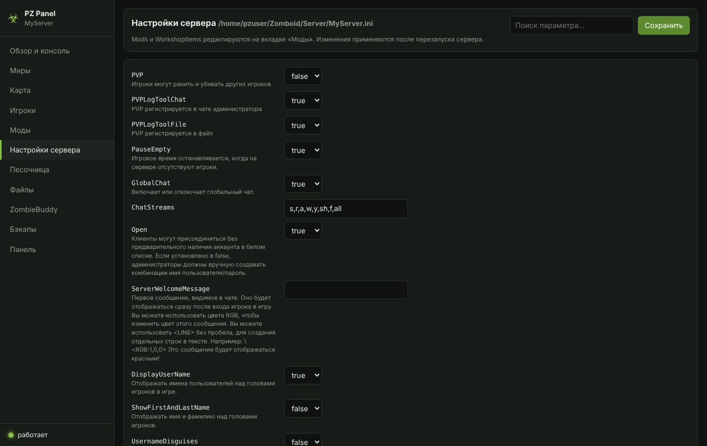
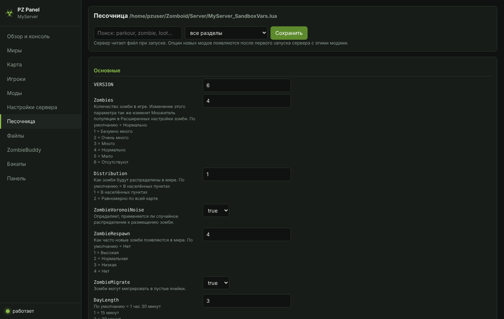

# PZ Panel — веб-панель выделенного сервера Project Zomboid (Build 42)

Небольшая программа на Java, которая работает рядом с выделенным сервером Project Zomboid и открывается в браузере.
Ничего ставить не нужно: Java берётся из самого сервера (`jre64`), библиотеки SQLite и JSON — из `projectzomboid.jar`.
Работает на Windows и Linux (на Linux — в том числе как служба systemd).

Подробная инструкция: [docs/PANEL.md](docs/PANEL.md) и руководство в Steam —
[PZ Panel](https://steamcommunity.com/sharedfiles/filedetails/?id=3823445245).

## Как это выглядит


| | |
|---|---|
| <br>**Миры** — несколько миров, сброс, копия, бэкап перед опасными действиями | <br>**Моды** — порядок перетаскиванием, Мастерская, «📌 Закрепить» |
| <br>**Карта** — здания, улицы, точки интереса, поиск и телепорт | <br>**Игроки** — роли, баны, последний вход |
| <br>**Настройки сервера** | <br>**Песочница** |
| <br>**Автосортировка модов** | <br>**English interface** |

## Что умеет

- **Обзор и консоль** — запуск, перезапуск с предупреждением игроков, остановка с сохранением, живая консоль,
  ответы на вопросы ZombieBuddy, ежедневный перезапуск, авто-перезапуск при падении.
- **Нагрузка** — ЦПУ и ОЗУ процесса сервера с графиками за 30 минут, лимит Java (-Xmx), загрузка машины.
- **Миры** — несколько миров (имён сервера) с отдельными настройками, модами и песочницей:
  создать (копия настроек, полная копия, по умолчанию), сделать активным, сбросить (вайп, с аккаунтами или без),
  переименовать, удалить. Перед опасными действиями — автоматический бэкап.
- **Моды** — порядок загрузки перетаскиванием, добавление из Мастерской (по ссылке, коллекцией, поиском),
  проверка зависимостей; видит замороженные (локальные) моды в `Zomboid/mods`.
- **Автосортировка модов** — «исправить порядок» по `require` / `loadModAfter` / `loadModBefore` или «по категориям и алфавиту», с предпросмотром.
- **Скачивание замороженных модов** — кнопка «⬇ Скачать с сервера»: один мод или архив всех модов; на сервере хранится один полный архив, архив одного мода удаляется через сутки.
- **Язык интерфейса** — русский и английский, выбор запоминается у каждого пользователя.
- **Карта** — карта мира с игроками, зданиями по категориям (аптеки, оружейные, полиция…), улицами, городами,
  плотностью зомби, поиском и телепортом; подложка «вид сверху» по этажам (через pzmap2dzi).
- **Игроки, настройки сервера, песочница, файлы, ZombieBuddy, бэкапы** (с восстановлением).
- Вход по паролю, токен против CSRF, защита от подмены Host.

## Скачать готовое

Готовые архивы — в разделе **Releases**: `PZPanel_<версия>_Windows.zip` и `PZPanel_<версия>_Linux.zip`.

- **Windows:** распакуйте папку `PZPanel` внутрь папки `Project Zomboid Dedicated Server` и запустите `PZPanel.bat`.
  Откроется http://127.0.0.1:8766/.
- **Linux** (сервер в `~/pzserver` от пользователя `pzuser`): из распакованной папки `PZPanel`
  ```bash
  bash install_panel.sh                  # панель в ~/pzserver/PZPanel
  sudo bash install_panel.sh --service   # ещё и служба systemd pzpanel
  ```
  Открыть с вашего ПК: `ssh -L 8766:127.0.0.1:8766 pzuser@IP_СЕРВЕРА` → http://127.0.0.1:8766/

Доступ снаружи (через домен или прокси) — только с паролем `panelPassword`, см. раздел «Безопасность» в
[docs/PANEL.md](docs/PANEL.md).

## Сборка из исходников

Нужны **JDK 21+** и **`projectzomboid.jar`** из вашего выделенного сервера
(`<папка сервера>/java/projectzomboid.jar`). Файлы игры в репозиторий не входят.

```bash
# только pzpanel.jar
PZ_JAR=/путь/к/projectzomboid.jar bash src/build.sh

# pzpanel.jar + готовые архивы для Windows и Linux в out/
PZ_JAR=/путь/к/projectzomboid.jar bash scripts/package.sh
```

На Windows: `src\build.bat "C:\...\Project Zomboid Dedicated Server\java\projectzomboid.jar"`.
Если папка `src` лежит внутри `PZPanel` в папке сервера, путь можно не указывать.

JDK: Linux — `sudo apt install -y openjdk-21-jdk-headless`, Windows — `winget install EclipseAdoptium.Temurin.21.JDK`.

## Структура

| Путь | Что там |
|---|---|
| `src/pzpanel/` | Java-код (сервер HTTP на `com.sun.net.httpserver`, без сторонних зависимостей) |
| `src/web/` | интерфейс: `index.html`, `app.js`, `map.js`, `style.css` |
| `src/build.sh`, `src/build.bat` | сборка `pzpanel.jar` |
| `dist/windows/` | `PZPanel.bat`, `render_top_view.bat/.ps1` (подложка «вид сверху»), README |
| `dist/linux/` | `pzpanel.sh`, `pzpanel.service`, `install_panel.sh`, README |
| `scripts/package.sh` | сборка релизных архивов |
| `docs/PANEL.md` | полная инструкция |

Сторонние компоненты — [NOTICE.md](NOTICE.md).
