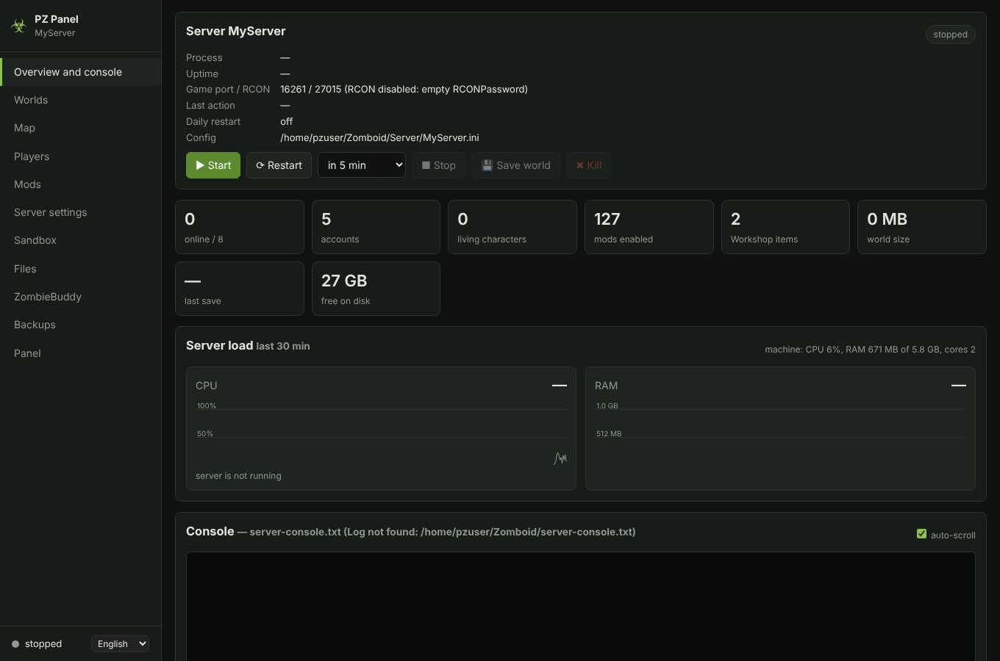

[⬅ Main README](../../README.md) · [Overview](README.md) · [Install](INSTALL.md) · [Configuration](CONFIG.md) · [Mods](MODS.md) · [Map](MAP.md) · [Docker](DOCKER.md) · [Architecture](ARCHITECTURE.md) · [Troubleshooting](TROUBLESHOOTING.md)

# Configuration

## Panel options (`panel.properties`)

The file sits next to `pzpanel.jar`. You can also edit it on the "Panel" tab. Restart the panel after changing `bind`/`port`.

| Option | Default | What it is |
|---|---|---|
| `serverDir` | the folder above the panel | Dedicated server folder |
| `startScript` | `StartServer64.bat` / `start-server.sh` | Server start script |
| `zomboidDir` | `~/Zomboid` | Configs, worlds, logs, `mods` |
| `serverName` | from `-servername` in the start script | Server name: `<name>.ini`, world `Saves/Multiplayer/<name>` |
| `bind`, `port` | `127.0.0.1`, `8766` | Where the panel listens |
| `panelPassword` | empty | Login password (required if `bind` is not 127.0.0.1) |
| `openBrowser` | `true` | Open the browser on start (Windows only) |
| `autoStartServer` | `false` (Linux install: `true`) | Start the server together with the panel |
| `stopServerOnExit` | `false` (Linux install: `true`) | On panel exit — save + quit the server |
| `stopTimeoutSec` | `170` | How long to wait for the server to shut down |
| `autoRestartOnCrash` | `false` | Restart a crashed server (one started from the panel) |
| `dailyRestart` | empty | Daily restart at `HH:MM` (server time) |
| `restartWarnMinutes` | `5` | How many minutes ahead to warn players |
| `serverMode` | `local` | `remote` — the server runs in another container: "running" is detected by an open RCON port, start and hard stop are done with container tools — see [DOCKER.md](DOCKER.md) |
| `startRequestFile` | empty | With `serverMode=remote` the "Start" button creates this file (for example `/requests/start`) and an external handler (systemd path unit, script) runs `docker start`. Empty — the button answers that the server must be started with container tools |
| `rconHost` | `127.0.0.1` | RCON address of the server; with `serverMode=remote` — the container name or server host |
| `gameVersion` | `42.21` | Used to check a mod's `versionMax` |
| `pyramidZip` | auto | Path to the map's `pyramid.zip` if it was not found by itself |
| `workshopDirs` | auto | Extra Workshop folders, separated by `;` |
| `zbConfigDir` | `~/.zombie_buddy` | Where ZombieBuddy approvals live |
| `steamcmd` | empty | Path to `steamcmd.sh`: needed by the "📌 Pin" button if the server has not downloaded the mod yet. On Windows it can be omitted: the panel looks for `PZPanel\steamcmd\steamcmd.exe` and `C:\steamcmd\steamcmd.exe`, and if neither exists it downloads SteamCMD itself |
| `steamcmdCache` | `/tmp/pzws` (Windows: `PZPanel\steamcmd_cache`) | Temporary `steamcmd` download folder (removed after pinning) |
| `modArchiveTtlHours` | `24` | After how many hours a **single-mod** archive in `PZPanel/mod_archives/` is deleted (a full archive is always kept as one copy) |
| `mapDir` | `<serverDir>/media/maps/Muldraugh, KY` | Map files for the layers (buildings, streets, zones) |
| `topViewDir` | `<panel>/map/html/map_data/base_top` | Result of the "top view" render |

## Server files

The "Server settings" and "Sandbox" tabs edit `<name>.ini` and `<name>_SandboxVars.lua` as forms; the "Files" tab edits any config as text (spawn points, client mods, the start script). Before every save the previous version of the file is put in `PZPanel/file_backups/`. Changes apply after a server restart — the panel shows a "restart needed" badge.

## Interface language

At the bottom of the sidebar there is a **Русский / English** switch. The choice is remembered in each user's browser (by default — the browser language) and does not affect other users. The interface texts, messages and confirmations are translated on the fly with the dictionary `src/web/lang_en.js`; a new language is added with a similar file. Descriptions of `.ini` options come from the server file itself and are not translated.
