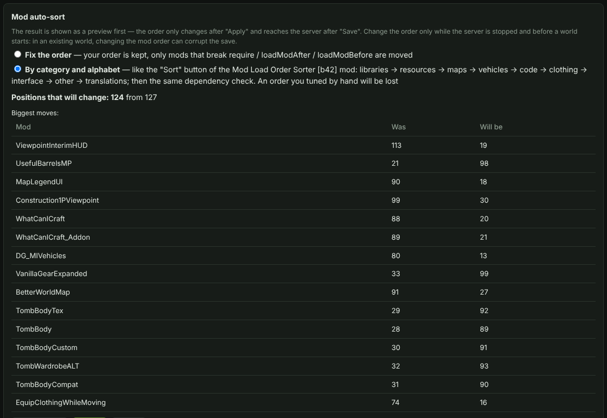

[⬅ Main README](../../README.md) · [Overview](README.md) · [Install](INSTALL.md) · [Configuration](CONFIG.md) · [Mods](MODS.md) · [Map](MAP.md) · [Docker](DOCKER.md) · [Architecture](ARCHITECTURE.md) · [Troubleshooting](TROUBLESHOOTING.md)

# Mods

## Frozen mods

After freezing (`scripts/04_freeze_mods.sh` or `freeze_mods.bat`) the mods on the "Mods" tab are marked **"local"**, and the "Workshop items" list is empty — that is how it should be.

If you add a **new** mod from the Workshop through the panel, its item goes into `WorkshopItems=` and the server will download only it from Steam. To freeze it too: stop the server → start it once (the mod downloads) → stop it → `bash scripts/04_freeze_mods.sh` (on Windows `freeze_mods.bat`) → send players the new mod archive (it appears in `~`, on Windows in the server folder). Already frozen mods are neither copied nor updated again — only the new one is added, and the archive is built with all the mods. If the server is not frozen and the mods were just updated, `bash scripts/03_build_mods_archive.sh` builds a fresh archive without changing anything.

### Pin a Workshop mod right in the panel

Next to an item in the "Workshop items" list there is a **"📌 Pin"** button. The panel takes the mod from the server's `steamapps/workshop/content/108600/<id>` (if it is not there it downloads it with `steamcmd`, the `steamcmd` option is needed), copies the mod's folders to `Zomboid/mods`, appends to `_frozen_manifest.txt` and removes the ID from `WorkshopItems=`. From then on the server does not update this mod from Steam, and on the "Mods" tab it is marked **"📌 pinned"**. A server restart is needed. If the mod has Java code (`.jar`) the panel shows its sha256 and offers to write an approval to ZombieBuddy — otherwise the server blocks the mod on start. The archive for players is still built by the freeze script.

**On Windows:**
- the mod is looked up first among those already downloaded: the server's Workshop, then the Steam client's Workshop on this PC (`<Steam library>\steamapps\workshop\content\108600`) and the folders from `workshopDirs`. A folder downloaded by the client is not deleted;
- if the mod is nowhere, SteamCMD does the job (anonymously, no Steam account needed). If it is not found the panel downloads it from Valve's site into `PZPanel\steamcmd`. The first SteamCMD run updates itself, so the first pin takes longer;
- **you can pin only while the server is stopped**: while it runs, Windows keeps the mod files (`.jar`) open;
- the panel also appends to `_frozen_workshop_items.txt`, so `freeze_mods.bat` and `pack_mods.bat` see the pinned mod.

## Mod auto-sorter

On the "Mods" tab the **"Sort…"** button orders the list of enabled mods. The idea is the same as the [Mod Load Order Sorter [b42]](https://steamcommunity.com/sharedfiles/filedetails/?id=3423660713) mod, but it works on the server, before the game starts. A preview is shown first (what moves where, warnings); the order changes only after **"Apply"** and reaches the server after **"Save"**.

- **Fix the order** — your order is kept, only the mods that break `require`, `loadModAfter`, `loadModBefore` are moved (a stable topological sort).
- **By category and alphabet** — libraries → resources → maps → vehicles → code → clothing → interface → other → translations, alphabetical inside a category; then the same dependency check. A hand-tuned order is lost.
- Circular dependencies and the mods that depend on them stay at the end of the list and are reported in the warnings; missing requirements and incompatible pairs (`incompatible`) are shown too.

Change the mod order only while the server is stopped and before the game starts: in an already started world, changing the order can corrupt the save.

## Downloading mods by players

Every **frozen** mod (tag "local" / "📌 pinned") on the "Mods" tab has a **"⬇ Download from server"** button. It opens a choice:

- **Only this mod** — a zip with the mod's folder(s) (`PZ_mod_<name>_<time>.zip`);
- **All installed mods** — a full archive (`PZ_mods_all_<time>.zip`): all folders from `Zomboid/mods`, a `default.txt` with the server's order, a manifest and a README. It can also be built with the "Prepare archive" button in the "Mod archives for players" card.

The archive is built in the background with a progress indicator, then a download link appears (panel login required). The archive folder is `PZPanel/mod_archives/`. **Retention policy** (checked every 10 minutes and on every build):

- there is always **one** full archive — a new one replaces the old;
- a single-mod archive is deleted after **24 hours** (option `modArchiveTtlHours`); a fresh archive of the same mod is reused;
- unfinished `.part` files are deleted. Any archive can be deleted by hand.
