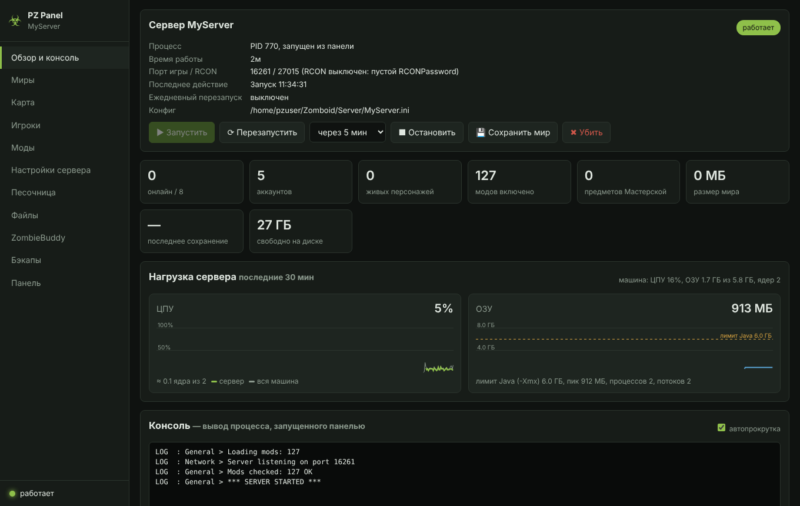
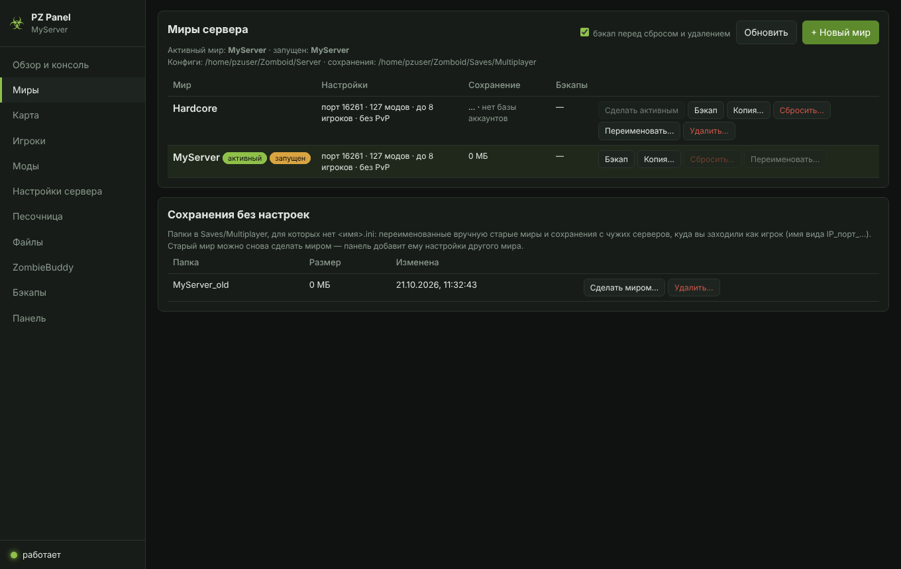
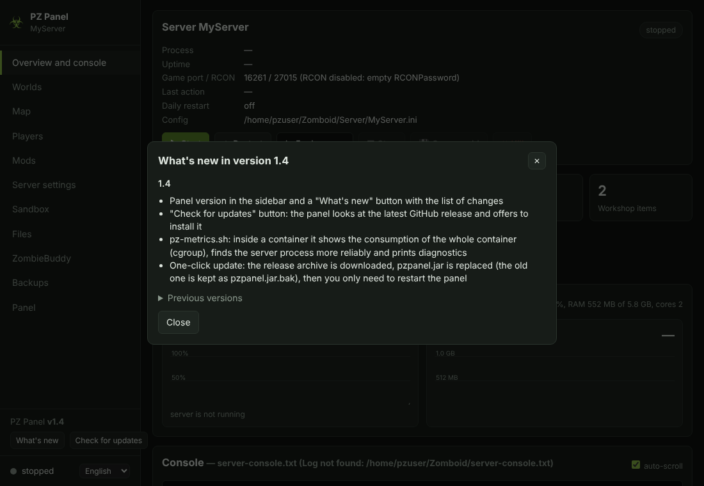
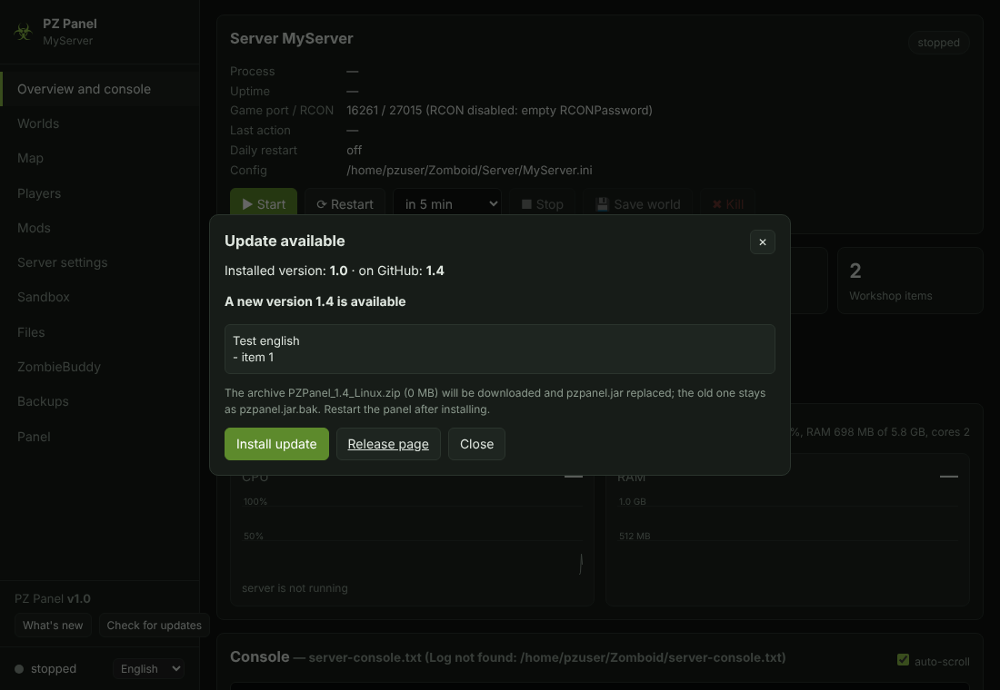

[⬅ Main README](../../README.md) · [Overview](README.md) · [Install](INSTALL.md) · [Configuration](CONFIG.md) · [Mods](MODS.md) · [Map](MAP.md) · [Docker](DOCKER.md) · [Architecture](ARCHITECTURE.md) · [Troubleshooting](TROUBLESHOOTING.md)

# PZ Panel — overview

PZ Panel is a web panel for a Project Zomboid (Build 42) dedicated server. It is a small Java program (`pzpanel.jar`, about 200 KB) that runs next to the server and opens in a browser: from a PC, a phone or over the internet. There is nothing to install: Java comes from the server itself (`jre64`), the SQLite and JSON libraries from `projectzomboid.jar`. It runs on Windows and Linux (on Linux as a systemd service or in a separate Docker container).

## Tabs

| Tab | What it does |
|---|---|
| **Overview and console** | Server state, uptime, players online. **Load**: CPU and RAM of the server process (with child processes) as 30-minute charts, the Java limit (-Xmx), peak memory, whole-machine load. Buttons: start, restart (warning players 1/5/10 minutes ahead), stop (save + quit), save the world, kill the process. Live console and command input (`players`, `servermsg "text"`, `additem` …). ZombieBuddy `[y/n]` prompts as Yes/No buttons |
| **Worlds** | Several worlds (server names), each with its own settings, mods and sandbox; create, make active, reset (wipe), copy, rename, delete; an automatic backup before dangerous actions |
| **Map** | Interactive world map — see [Map](MAP.md) |
| **Players** | Accounts, roles, last login, characters and their coordinates; kick, ban, role change |
| **Mods** | Load order (drag and drop), enable/disable, checks of `require` / `loadModAfter` / `versionMax`. Workshop search, add by link/ID, collection import. The **"local"** tag means the mod lives in `Zomboid/mods` (frozen). See [Mods](MODS.md) |
| **Server settings** | `<name>.ini` as a form, with search |
| **Sandbox** | `<name>_SandboxVars.lua` as a form, grouped (mod options too) |
| **Files** | Any config as text: ini, sandbox, spawn points, client mods, the start script |
| **ZombieBuddy** | Java mod approvals (`mod_approvals.json`) |
| **Backups** | World zip copies: create, download, restore, delete |
| **Panel** | Settings of the panel itself (`panel.properties`) |

## Highlights

- **Mods** — drag-and-drop load order, Workshop search, version freezing ("📌 Pin"), an [auto-sorter](MODS.md#mod-auto-sorter) and [downloading frozen mods by players](MODS.md#downloading-mods-by-players).
- **Worlds** — several worlds with their own settings, mods and sandbox; reset, copy, rename, automatic backup before dangerous actions.
- **Map** — players, buildings by category, streets, zombie density, search, teleport, a "top view" underlay — see [Map](MAP.md).
- **Load** — server CPU and RAM with 30-minute charts.
- **Interface language** — Russian and English, remembered per user ([details](CONFIG.md#interface-language)).
- **Security** — password login (`panelPassword`), a CSRF token, Host header protection; by default the panel listens on `127.0.0.1` only.

## Version and updates

The sidebar below the tab list shows the panel version and two buttons:

- **"What's new"** — a window with the changes of the current version (and earlier ones) in the selected interface language. After an update the window opens once by itself.
- **"Check for updates"** — the panel asks for the latest release in the GitHub repository (the server needs access to `api.github.com`) and compares it with its own version. If a new one is out it shows the notes and offers **"Install update"**: the release archive for your system is downloaded, `pzpanel.jar` is taken from it, the old one is kept as `pzpanel.jar.bak`, and you only need to restart the panel. Launch scripts and `panel.properties` are not changed. On Windows a running jar cannot be replaced — the new file waits as `pzpanel.jar.new` and is put in place on the next start of `PZPanel.bat`.

## Where next

| Document | What is inside |
|---|---|
| [INSTALL.md](INSTALL.md) | Installing on Windows and Linux, the systemd service, access from your PC, building from source |
| [CONFIG.md](CONFIG.md) | All `panel.properties` options, the interface language, config files |
| [MODS.md](MODS.md) | Mods: freezing, "Pin", auto-sorter, downloads for players |
| [MAP.md](MAP.md) | The map and the "top view" underlay |
| [DOCKER.md](DOCKER.md) | Panel and server in different containers (`serverMode=remote`) |
| [ARCHITECTURE.md](ARCHITECTURE.md) | Technical description: design, HTTP API, security, build |
| [TROUBLESHOOTING.md](TROUBLESHOOTING.md) | Common problems |

Steam guide: [PZ Panel](https://steamcommunity.com/sharedfiles/filedetails/?id=3823445245). Third-party components: [NOTICE.md](../../NOTICE.md).
