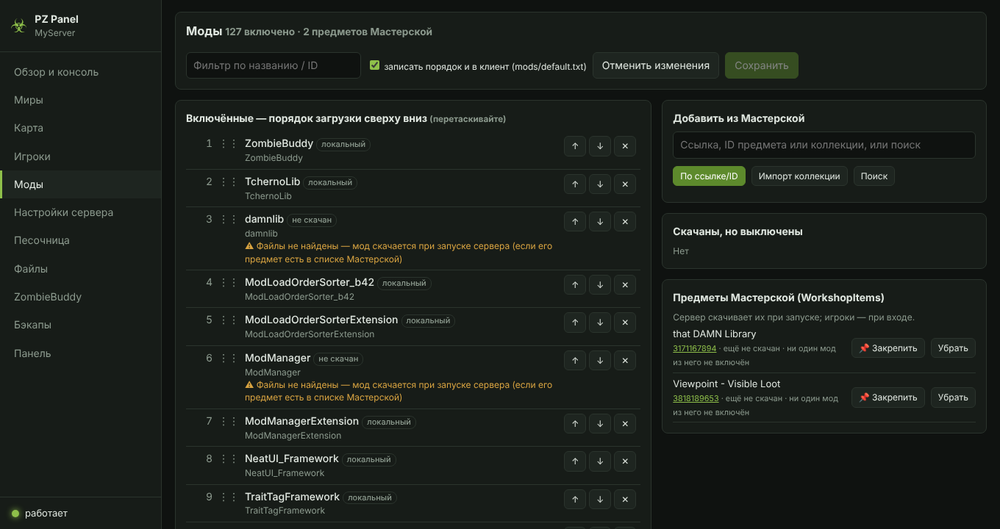
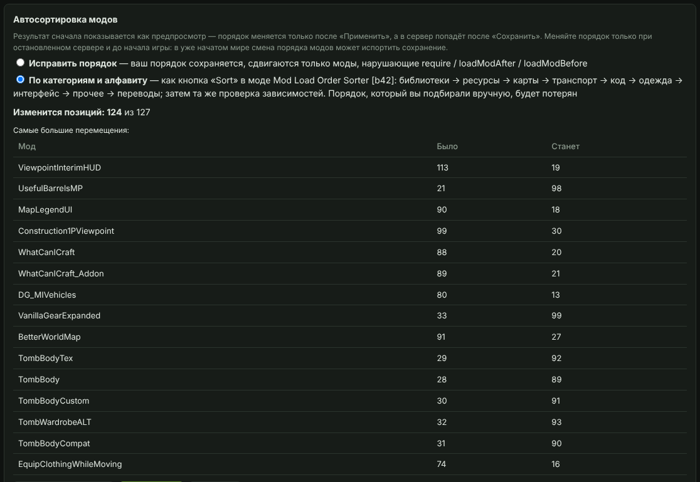
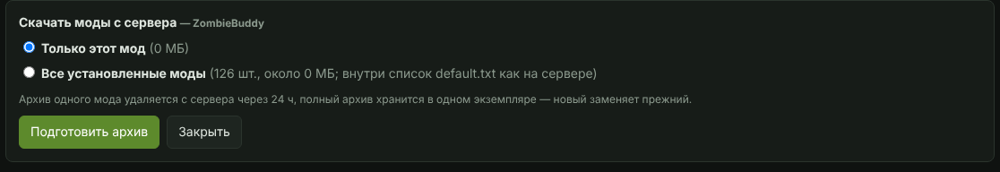

[⬅ К главному README](../../README.md) · [Описание](README.md) · [Установка](INSTALL.md) · [Настройки](CONFIG.md) · [Моды](MODS.md) · [Карта](MAP.md) · [Docker](DOCKER.md) · [Устройство](ARCHITECTURE.md) · [Проблемы](TROUBLESHOOTING.md)

# Моды

## Замороженные моды

После заморозки (`scripts/04_freeze_mods.sh` или `freeze_mods.bat`) моды на вкладке «Моды» помечены **«локальный»**, а список «Предметы Мастерской» пуст — так и должно быть.

Если добавить через панель **новый** мод из Мастерской, его предмет попадёт в `WorkshopItems=`, и сервер будет качать из Steam только его. Чтобы заморозить и его:
остановите сервер → запустите один раз (мод скачается) → остановите → `bash scripts/04_freeze_mods.sh` (на Windows — `freeze_mods.bat`) → разошлите игрокам новый архив модов (он появится в `~`, на Windows — в папке сервера). Уже замороженные моды при этом не перекопируются и не обновятся — добавится только новый, а архив соберётся со всеми модами. Если сервер не заморожен и моды просто обновились — `bash scripts/03_build_mods_archive.sh` соберёт свежий архив, ничего не меняя.

### Закрепить мод из Мастерской прямо в панели

Рядом с предметом в списке «Предметы Мастерской» есть кнопка **«📌 Закрепить»**. Панель берёт мод из
`steamapps/workshop/content/108600/<id>` сервера (если его там нет — скачивает `steamcmd`, нужен параметр `steamcmd`),
копирует папки мода в `Zomboid/mods`, дописывает `_frozen_manifest.txt` и убирает ID из `WorkshopItems=`.
Дальше сервер этот мод из Steam не обновляет, а на вкладке «Моды» он помечен **«📌 закреплён»**. Нужен перезапуск сервера.
Если в моде есть Java-код (`.jar`), панель покажет его sha256 и предложит записать одобрение в ZombieBuddy —
иначе сервер заблокирует мод при запуске. Архив для игроков по-прежнему собирается скриптом заморозки.

**На Windows:**
- мод сначала ищется среди уже скачанных: Мастерская сервера, затем Мастерская Steam-клиента на этом ПК
  (`<библиотека Steam>\steamapps\workshop\content\108600`) и папки из `workshopDirs`. Скачанная клиентом папка не удаляется;
- если мода нигде нет, работает SteamCMD (анонимно, аккаунт Steam не нужен). Не найден — панель сама скачает его
  с сайта Valve в `PZPanel\steamcmd`. Первый запуск SteamCMD обновляет сам себя, поэтому первое закрепление дольше;
- **закреплять можно только при остановленном сервере**: пока он работает, Windows держит файлы модов (`.jar`) открытыми;
- панель дописывает и `_frozen_workshop_items.txt`, так что `freeze_mods.bat` и `pack_mods.bat` видят закреплённый мод.

## Автосортировка модов

На вкладке «Моды» кнопка **«Сортировать…»** упорядочивает список включённых модов. Идея — как у мода [Mod Load Order Sorter [b42]](https://steamcommunity.com/sharedfiles/filedetails/?id=3423660713), но работает на сервере, до запуска игры. Сначала показывается предпросмотр (что и куда сдвинется, предупреждения), порядок меняется только после **«Применить»**, а в сервер попадает после **«Сохранить»**.

- **Исправить порядок** — ваш порядок сохраняется, сдвигаются только моды, нарушающие `require`, `loadModAfter`, `loadModBefore` (устойчивая топологическая сортировка).
- **По категориям и алфавиту** — библиотеки → ресурсы → карты → транспорт → код → одежда → интерфейс → прочее → переводы, внутри категории по алфавиту; затем та же проверка зависимостей. Ручной порядок будет потерян.
- Циклические зависимости и моды, которые от них зависят, остаются в конце списка и перечисляются в предупреждениях; также показываются отсутствующие требования и несовместимые пары (`incompatible`).

Меняйте порядок модов только при остановленном сервере и до начала игры: в уже начатом мире смена порядка может испортить сохранение.

## Скачивание модов игроками

У каждого **замороженного** мода (метка «локальный» / «📌 закреплён») на вкладке «Моды» есть кнопка **«⬇ Скачать с сервера»**. Она открывает выбор:

- **Только этот мод** — zip с папкой(ами) мода (`PZ_mod_<имя>_<время>.zip`);
- **Все установленные моды** — полный архив (`PZ_mods_all_<время>.zip`): все папки из `Zomboid/mods`, `default.txt` с порядком как на сервере, манифест и README. Его же можно собрать кнопкой «Подготовить архив» в карточке «Архивы модов для игроков».

Архив собирается в фоне с индикатором, потом появляется ссылка для скачивания (нужен вход в панель). Папка архивов — `PZPanel/mod_archives/`. **Политика хранения** (проверяется раз в 10 минут и при каждой сборке):

- полный архив всегда **один** — новый заменяет прежний;
- архив одного мода удаляется через **24 часа** (параметр `modArchiveTtlHours`); свежий архив того же мода используется повторно;
- недособранные `.part`-файлы удаляются. Любой архив можно удалить вручную.
